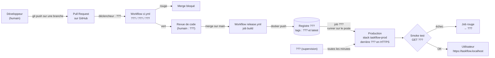

# TP 0 : cartographie d'un pipeline

> **Durée** : 1h (jour 1, fin de matinée) | **Format** : groupes de 3 ou 4
> **Objectif** : repérer ce qui rend une mise en production risquée, lire un workflow GitHub Actions sans l'écrire,
> puis dessiner le pipeline que vous allez construire pour TaskFlow pendant la semaine.

---

## Ce dont vous avez besoin

- Ce dossier : `README.md` (cet énoncé) et [`workflow-exemple.yml`](workflow-exemple.yml) (à ouvrir dans VS Code).
- De quoi dessiner : une feuille A3, ou <https://excalidraw.com>, ou un éditeur mermaid (<https://mermaid.live>).
- Les slides du bloc 1.1 à 1.3 (boucle DevOps, intégration continue, livraison continue, déploiement continu).

**Vocabulaire utile**

| Terme | Signification |
|---|---|
| **Production** (« la prod ») | L'environnement où se trouvent les vrais utilisateurs |
| **Déployer** | Mettre une nouvelle version de l'application en production |
| **FTP** (*File Transfer Protocol*) | Ancien protocole d'envoi de fichiers vers un serveur, **non chiffré** |
| **PR** (*Pull Request*) | Demande de fusion d'une branche dans `main`, avec revue de code |
| **Pipeline** | La suite d'étapes automatiques entre « j'ai écrit du code » et « il tourne en production » |
| **CI** (*Continuous Integration*, intégration continue) | À chaque push, une machine vérifie le code : lint, tests, build |
| **Livraison continue** (*Continuous Delivery*) | Chaque version vérifiée est prête à partir en production ; un humain appuie sur le bouton |
| **Déploiement continu** (*Continuous Deployment*) | Chaque version vérifiée part en production **sans** intervention humaine |

---

## Étape 1 : lire l'étude de cas « La Fromagerie » (10 min)

Lisez le récit seul, en silence, **un crayon à la main** : soulignez chaque phrase qui vous semble poser problème.

> ### La Fromagerie Durand
>
> La Fromagerie Durand vend ses fromages en ligne depuis cinq ans. Le site (PHP et MySQL) a été développé par
> **Julien**, le neveu du patron, aujourd'hui seul développeur salarié. Depuis septembre, il est aidé par **Sofia**,
> apprentie DWWM, et par **Marc**, un développeur indépendant qui intervient deux jours par mois.
>
> Il n'y a pas de dépôt Git : le code de référence, « c'est ce qu'il y a sur le serveur ». Chacun récupère les fichiers
> avec FileZilla, travaille sur son ordinateur, puis renvoie ses fichiers par FTP. Sur le poste de Julien, le dossier
> `site/` contient `panier.php`, `panier_v2.php`, `panier_v2_OK.php` et `panier_NE_PAS_TOUCHER.php`. Personne ne sait
> plus lequel est réellement utilisé.
>
> Les identifiants FTP et le mot de passe de la base de données sont écrits sur un post-it collé sous l'écran de
> Julien. Le mot de passe de la base est aussi en clair dans `config.php`, que Marc a déjà envoyé par mail à un ami
> « pour avoir un coup de main ».
>
> Comme la boutique est calme le week-end, l'équipe met en ligne **le vendredi à 18h**, une fois par mois, toutes les
> nouveautés du mois en même temps. Il n'existe pas de site de test : on vérifie « en vrai », directement sur la boutique.
>
> Vendredi dernier, Sofia a envoyé sa nouvelle page « Plateau de fromages ». Elle avait testé sur son ordinateur avec
> PHP 8.3 ; le serveur est en PHP 7.4. Résultat : une page blanche sur tout le site. Au même moment, Marc a renvoyé
> `header.php`, qu'il avait modifié de son côté : la correction de Julien faite le mardi a été **écrasée** sans que
> personne ne s'en rende compte.
>
> Pour la page « Plateau de fromages », il fallait aussi ajouter une colonne `plateau_id` dans la table `commandes`.
> Julien l'a fait à la main sur sa base locale, mais a oublié de le faire sur le serveur.
>
> Il n'y a aucun test automatisé. « On clique un peu partout avant de partir », explique Julien. Aucun outil ne surveille
> le site : c'est un client qui a appelé le samedi matin pour signaler que la boutique était cassée.
>
> Samedi, Julien a voulu revenir à la version précédente, mais personne n'avait gardé de copie complète. La dernière
> sauvegarde de la base date de mars ; elle n'a jamais été restaurée pour vérifier qu'elle fonctionne. Il a fallu
> six heures pour reconstituer un site qui marche.
>
> Lundi, réunion avec le patron. Première question : « **Qui** a cassé le site ? » Sofia n'ose plus envoyer de fichiers.
> Marc propose de « faire plus attention la prochaine fois ».

---

## Étape 2 : lister et classer les problèmes (10 min)

En groupe, remplissez ce tableau (une ligne par problème, **visez au moins 10 problèmes**). Pour la colonne « Étape de
la boucle », utilisez les étapes vues ce matin : *plan → code → build → test → release → deploy → operate → monitor*.

| # | Problème repéré (une phrase) | Étape de la boucle | Conséquence | Ce qui l'éviterait |
|---|---|---|---|---|
| 1 | Pas de dépôt Git : le serveur sert de référence | code | Modifications écrasées, impossible de revenir en arrière | Git + GitHub |
| 2 | | | | |
| 3 | | | | |
| … | | | | |

**Résultat attendu** : un tableau d'au moins 10 lignes, et chaque étape de la boucle apparaît au moins une fois.

> **Si vous bloquez**
> - Relisez le récit en vous demandant, paragraphe par paragraphe : « qu'est-ce qui pourrait mal tourner ici ? ».
> - Cherchez aussi les problèmes **humains** : qui détient l'information ? que se passe-t-il le lundi ?

> **Pourquoi ?** Le DevOps est d'abord une réponse à ce genre de situation. Chaque outil de la semaine (Git, Docker,
> GitHub Actions, Nginx, la supervision) répond à au moins une ligne de votre tableau.

**Question de réflexion** (après avoir rempli le tableau) : la réunion du lundi cherche un coupable. Pourquoi est-ce une
mauvaise question ? Quelle question faudrait-il poser à la place ?

---

## Étape 3 : lire un vrai workflow GitHub Actions (15 min)

Ouvrez [`workflow-exemple.yml`](workflow-exemple.yml) dans VS Code. C'est le pipeline d'un site vitrine construit avec
Vite. **Vous ne l'écrivez pas** : vous le lisez, comme on lit le code d'un collègue avant une revue.

> **Rappel de vocabulaire GitHub Actions**
> - **Workflow** : un fichier YAML dans `.github/workflows/`. **YAML** est un format texte où l'indentation compte (comme en Python).
> - **Événement / déclencheur** (`on:`) : ce qui lance le workflow (un push, une PR, un clic…).
> - **Job** : une suite d'étapes exécutée sur **une** machine. Les jobs tournent en parallèle, sauf s'ils ont un `needs:`.
> - **Step** : une étape d'un job : soit une commande (`run:`), soit une action toute faite (`uses:`).
> - **Runner** : la machine qui exécute le job (`runs-on:`).

Répondez par écrit, en citant le **numéro de ligne** qui justifie votre réponse :

1. Quels sont les **trois déclencheurs** de ce workflow (lignes 15 à 20) ? Lequel est manuel ?
2. Combien y a-t-il de **jobs** ? Dans quel ordre s'exécutent-ils, et quel mot-clé impose cet ordre ?
3. Sur quelle machine tourne le job `verifier` (ligne 29) ? Cette machine existe-t-elle encore après le job ?
4. Que se passe-t-il si `npm test` (ligne 47) échoue ? Le site est-il quand même déployé ?
5. Sofia ouvre une Pull Request. Quels jobs s'exécutent ? Pourquoi `deployer` ne s'exécute-t-il pas (ligne 78) ?
6. À quoi sert l'**artefact** (ligne 67) ? Pourquoi ne pas relancer `npm run build` dans le job `deployer` ?
7. Lignes 95 et 96 : quelle est la différence entre `secrets.SSH_PRIVATE_KEY` et `vars.SERVER_HOST` ? Pourquoi la clé
   n'est-elle pas écrite directement dans le fichier ?
8. À quoi sert le dernier step (ligne 109) ? Que se passe-t-il si le site ne répond pas ?
9. Ce workflow fait-il de la **livraison continue** ou du **déploiement continu** ? Qu'est-ce qui changerait si on ajoutait
   une approbation obligatoire sur l'environnement `production` (ligne 82) ?
10. Reprenez votre tableau de l'étape 2 : quels problèmes de La Fromagerie ce workflow résout-il ? Lesquels **ne sont
    pas** résolus ? Quelle étape de la boucle DevOps est absente de ce fichier ?

**Résultat attendu** : dix réponses courtes, chacune avec au moins un numéro de ligne.

> **Si ça ne marche pas**
> - VS Code n'affiche pas les numéros de ligne : menu *Affichage* > *Apparence* > *Afficher les numéros de ligne*.
> - Vous ne comprenez pas une ligne : lisez le commentaire juste au-dessus, puis la fiche
>   [`../../ressources/cheatsheet-github-actions.md`](../../ressources/cheatsheet-github-actions.md).

> **Pourquoi ?** Savoir **lire** un workflow est la première compétence : en entreprise, vous arriverez sur des projets
> où le pipeline existe déjà. Mercredi, vous écrirez le vôtre.

---

## Étape 4 : dessiner le pipeline cible de TaskFlow (15 min)

TaskFlow est le gestionnaire de tâches qui vous suivra toute la semaine : un **front** (Vite, servi par Nginx), une
**API** (Node 20 + Express, port 3000, route `GET /health`) et une base **PostgreSQL**. Voici ce que vous allez construire :

| Jour | Ce qui sera en place |
|---|---|
| J2 | Un dépôt `taskflow` sur GitHub dont la branche `main` est protégée ; des images Docker pour l'API et le front |
| J3 | `docker compose` pour tout lancer en une commande ; un workflow `ci.yml` (lint, tests, build) sur chaque PR ; un workflow `release.yml` qui publie les images sur **ghcr.io** (le registre d'images de GitHub) après chaque merge |
| J4 | Une « production » sur votre poste (`~/taskflow-prod`), derrière Nginx en HTTPS ; un déploiement automatique après chaque merge, vérifié par un smoke test ; une supervision avec Uptime Kuma |

Dessinez ce pipeline **du développeur jusqu'à l'utilisateur**. Votre schéma doit faire apparaître :

| Élément | Exemple |
|---|---|
| Les **étapes** | lint, tests, build, publication des images, déploiement, smoke test, supervision |
| Les **outils** | Git, GitHub, GitHub Actions, Docker, ghcr.io, Nginx, Uptime Kuma |
| Les **déclencheurs** | « à chaque PR », « à chaque merge sur main », « toutes les minutes » |
| **Qui fait quoi** | humain (écrire, relire, merger) / machine (tout le reste) |
| Les **contrôles** | les endroits où le pipeline peut s'arrêter en rouge |

### Option : compléter le gabarit mermaid

Copiez ce bloc dans <https://mermaid.live> (ou dans un fichier `.md` ouvert dans VS Code avec l'aperçu Markdown) et
remplacez chaque `???`. Ajoutez des cases si besoin.

````markdown

````

**Résultat attendu** : un schéma lisible par quelqu'un qui n'était pas dans votre groupe, avec les cinq éléments du
tableau ci-dessus. Prenez-le en photo (ou exportez-le en PNG) : il servira de base à votre `docs/ARCHITECTURE.md` et à
votre présentation finale.

> **Si ça ne marche pas**
> - mermaid affiche « Syntax error » : vérifiez les guillemets autour des textes contenant des parenthèses ou des
>   deux-points, et qu'aucune flèche ne pointe vers une case non déclarée. En cas de doute, revenez au papier.
> - Vous ne savez pas où placer une étape : demandez-vous « est-ce une vérification (avant le merge) ou une livraison
>   (après le merge) ? ».

> **Pourquoi ?** On dessine avant de construire : si le groupe n'arrive pas à se mettre d'accord sur le schéma, il ne se
> mettra pas d'accord sur le code. Et ce schéma est exactement ce que le jury vous demandera d'expliquer.

---

## Étape 5 : restitution (10 min)

Chaque groupe présente en **2 minutes** :

1. les trois problèmes de La Fromagerie qui vous paraissent les plus graves, et pourquoi ;
2. votre schéma de pipeline : où sont les humains, où sont les contrôles automatiques ;
3. une question qui reste ouverte pour vous.

Les autres groupes ont une mission : repérer **une** différence entre leur schéma et celui présenté.

---

## Je valide avec le formateur

- [ ] Notre tableau liste au moins 10 problèmes, classés par étape de la boucle DevOps.
- [ ] Nous avons répondu aux 10 questions sur le workflow, avec des numéros de ligne.
- [ ] Notre schéma montre les étapes, les outils, les déclencheurs, qui fait quoi et les contrôles.
- [ ] Le schéma est photographié ou exporté, et chacun en a une copie.

## Pour aller plus loin (si vous avez fini en avance)

- Récrivez la soirée du vendredi de La Fromagerie **telle qu'elle se passerait** avec votre pipeline : que voit Sofia
  quand sa page ne marche pas en PHP 7.4 ? À quel moment ? Qui est prévenu ?
- Dans `workflow-exemple.yml`, que faudrait-il ajouter pour que le job `deployer` attende l'accord d'une personne ?
  (indice : ce n'est pas dans le fichier, c'est dans les réglages du dépôt).
